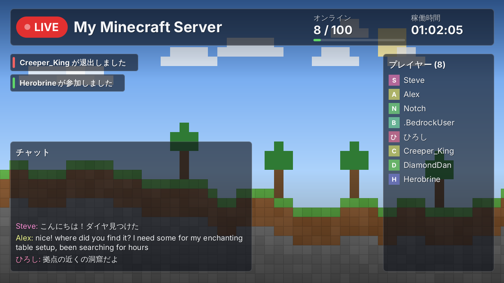

# YtStream — Minecraft → YouTube Live 自動配信プラグイン

ゲーム内で `/ytstream start` と打つだけで、サーバーの状態(オンライン人数・プレイヤー一覧・チャット・参加/退出通知・稼働時間)を載せた配信画面を **プラグイン自身が生成**し、FFmpeg経由でYouTube Liveへ送信します。OBSもブラウザ操作も不要です。



> **重要な前提**: 配信されるのは「背景画像+サーバー情報」で作ったオリジナル画面です。Minecraftのワールド(ゲーム画面)を撮影する機能ではありません。

## 技術構成と実現可能性

| 項目 | 方式 | 備考 |
|---|---|---|
| 対応サーバー | Paper / Purpur 1.21.x、Java 21 | Folia 非対応 |
| Java版/統合版 | Bukkit上のPlayerとして一括処理 | Geyser/Floodgate 導入環境で動作。Floodgate APIへの依存なし(名前プレフィックスで判別) |
| 映像生成 | Java2D(`BufferedImage`、外部ライブラリ不要) | 専用スレッドで描画。メインスレッドは使わない |
| エンコード/送信 | 外部の **FFmpeg**(stdinへBGR24生フレーム→x264/AAC→FLV→RTMP) | **要インストール**。ライセンス上、同梱しません |
| YouTube連携 | **ストリームキー方式**(v1) | YouTube Data API/OAuthでの枠自動作成は未実装(下記「制限」) |
| 依存関係 | Paper APIのみ(compileOnly) | JARに外部ライブラリは入りません |

### 性能・安定性の設計

- **メインスレッド非使用**: 描画・エンコード・プロセス監視はすべて専用スレッド。イベント受信側は固定長キューへ追加するだけ。
- **静止フレームの再利用**: 状態変化もアニメーションもないフレームは再描画せず前フレームを再送(CPUほぼゼロ)。720pのフル描画は1フレーム数ms。
- **ゼロ変換出力**: `TYPE_3BYTE_BGR` のバイト配列をそのままFFmpegへ書き込み。背景は起動時に1回生成し `arraycopy` で複製。
- **有界メモリ**: チャットは64件、通知は8件で固定。大量チャットでも破綻しません。
- **FFmpegの隔離**: エンコードは別プロセス(既定はスレッド2・`nice 10`)。FFmpegが落ちてもサーバーは無事で、指数バックオフで自動再接続します。
- **確実な後始末**: `stop`/`onDisable` で stdin を閉じてFLVを正常終了→待機→強制終了の順に停止。
- **状態管理は単一スレッド直列化**: ロック競合・状態レースを排除。

## 導入

1. **FFmpegを入れる**(`/ytstream ffmpeg` で確認できます)
   - Windows: `winget install Gyan.FFmpeg` / macOS: `brew install ffmpeg` / Debian・Ubuntu: `sudo apt install ffmpeg`
   - または実行ファイルを `plugins/YtStream/ffmpeg/` に置く、`config.yml` の `ffmpeg.path` に指定
2. **Linuxで文字が出ない/エラーになる場合**: `sudo apt install fontconfig fonts-noto-cjk`(日本語表示に必要)
3. `YtStream-1.0.0.jar` を `plugins/` に入れて起動
4. **ストリームキーを設定**(いずれか。上ほど優先)
   - 環境変数 `YTSTREAM_KEY`(推奨)
   - `plugins/YtStream/secrets.yml` に `stream-key: "xxxx-xxxx-xxxx-xxxx-xxxx"`(権限 600 推奨)
   - `config.yml` の `youtube.stream-key`(平文のため非推奨)
5. YouTube Studio 側で **ライブ配信を有効化**し、「ライブ配信」→「ストリームキー」を取得(新規チャンネルは有効化に最大24時間かかります)
6. ゲーム内/コンソールで `/ytstream start`

> ストリームキーをゲーム内コマンドで入力する機能は、コマンドログに残るため意図的に用意していません。

## コマンド(権限 `ytstream.admin`、既定はOP)

| コマンド | 内容 |
|---|---|
| `/ytstream start` | 配信開始(FFmpeg確認→映像生成→YouTubeへ接続) |
| `/ytstream stop` | 配信終了 |
| `/ytstream restart` | 再起動 |
| `/ytstream status` | 状態、配信時間、エンコード速度、再接続回数、直近のエラー |
| `/ytstream reload` | config.yml 再読み込み(実行中の配信へは restart 後に反映) |
| `/ytstream preview` | 配信せずに現在の画面を `plugins/YtStream/preview.png` に保存(レイアウト調整用) |
| `/ytstream ffmpeg` | FFmpegの検出・動作確認、導入案内 |

`ytstream.hide` 権限を持つプレイヤー(およびバニッシュ中のプレイヤー)は配信画面に映りません。

## 設定

`config.yml` に日本語コメント付きで全項目を記載しています。主な項目:
解像度/FPS/ビットレート、エンコーダ(`libx264` / `h264_nvenc` など)、背景画像、テーマ(`default` / `nether` / `end`)、パーツごとの表示ON/OFFと位置(画面比の相対座標)、チャットの伏せ字パターン、自動再接続、FFmpegのパス。
背景画像が無ければ内蔵のブロック風背景を自動生成します。解像度は 1280×720 / 1920×1080 などに対応(座標は相対なので崩れません)。

### 負荷の目安
720p30・2500kbps・`veryfast`・2スレッドが既定です。サーバーのCPUが厳しい場合は `fps: 15`、`preset: ultrafast`、`h264_nvenc`(GPUあり)を試してください。`/ytstream status` の「速度」が 1.0x 未満なら処理が追いついていません。

## セキュリティ

- ストリームキーはログ/チャット/エラー表示に出しません(出力は常にマスク。`Secret` 型で保持)。FFmpegの出力に含まれるURLも伏せ字化します。
- 子プロセスへは引数配列で渡すためシェル経由のコマンド注入は起きません。キーの形式も検証します。
- 送信先は既定で `*.youtube.com` のみ許可(`allow-custom-host` で解除)。スキン取得先も `textures.minecraft.net` に固定(リダイレクト無効・サイズ上限)。
- 背景画像/フォントのパスはプラグインフォルダ内に限定。設定値はすべて範囲検証され、不正値は安全な値に補正されます。
- **既知の制約**: FFmpegの引数(送信URL=キーを含む)は、同一マシン上の他ユーザーがプロセス一覧から読める場合があります。サーバーは専用ユーザーで動かし、共有ホストでは `hidepid` 等を併用してください。設定ファイル内のキーの「暗号化」は、復号鍵が同じ場所にある限り実効性が低いため行わず、環境変数/権限600のファイルを推奨としています。
- **プライバシー**: チャットとプレイヤー名は公開配信に映ります。不要なら `display.chat: false`、またはブロックパターンを使ってください。

## 制限・今後

- **YouTube Data API(OAuth)による配信枠の自動作成/開始/終了は未実装**です。現状は、YouTube Studio側の配信設定(永続ストリームキー+自動開始)と組み合わせる運用になります。API対応にはGoogle Cloudでのクライアント作成・同意画面の審査が必要で、導入が複雑になるため v1 では見送りました。
- FFmpegの自動ダウンロードは、改ざん検証・配布元の信頼性・ライセンス(GPL/LGPL)の問題があるため実装していません。`/ytstream ffmpeg` がOS別の導入コマンドを案内します。
- 音声は無音トラックのみ(ゲーム音声は対象外)。

## 拡張(テーマ/表示機能を足す)

- テーマ: `render/Theme.java` の `byName` と `SettingsLoader` の許可リストに追加
- 表示パーツ: `render/Widget.java` を実装(`render` と `isAnimating`)して `FrameRenderer` のコンストラクタに登録。座標は `Settings.DEFAULT_LAYOUT` に追加
- 映像生成は `ServerModel`(Bukkit非依存)だけを見るため、Bukkitなしでテスト可能です

## ビルド

```bash
gradle build            # build/libs/YtStream-1.0.0.jar(Java 21)
```
GitHub Actions(`.github/workflows/build.yml`)が push / PR / タグ `v*` で自動ビルドとテストを実行し、JARをアーティファクト(タグ時はReleaseにも)として保存します。

## トラブルシューティング

| 症状 | 対処 |
|---|---|
| FFmpegが見つからない | `/ytstream ffmpeg` の案内に従い導入、または `ffmpeg.path` を指定 |
| 接続直後に切れる/Input/output error | ストリームキー誤り、YouTube Studioでライブ未有効、同キーで別配信中 |
| 接続できない | TCP 1935(rtmps は 443)の送信許可を確認 |
| 日本語が□になる | `fonts-noto-cjk` を導入、または `theme.font-file` にTTFを指定 |
| 速度が1.0x未満 | fps/解像度/ビットレートを下げる、`preset: ultrafast`、GPUエンコーダ |
| YouTubeでプレビューが出ない | Studioで配信が「自動開始」でない場合は手動で「ライブ配信開始」を押す |
